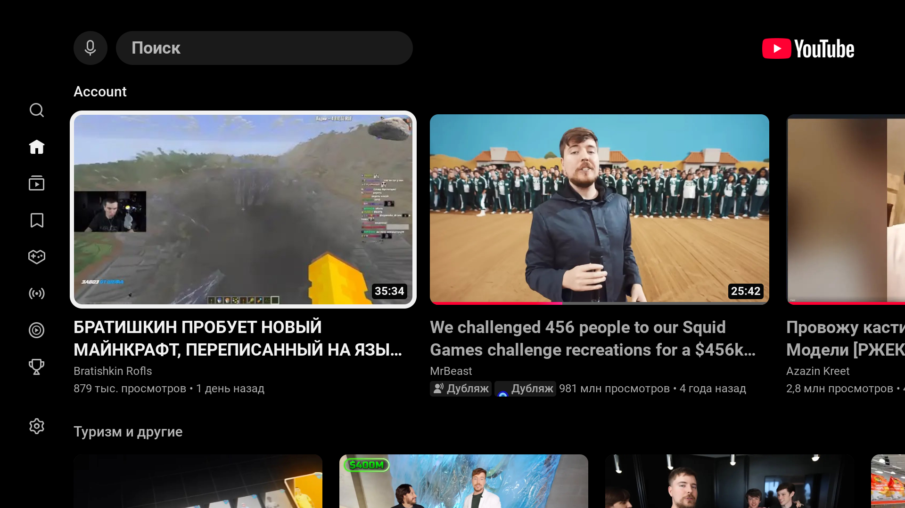
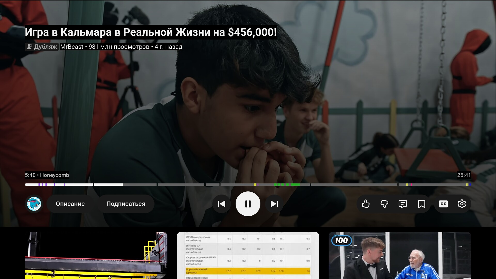
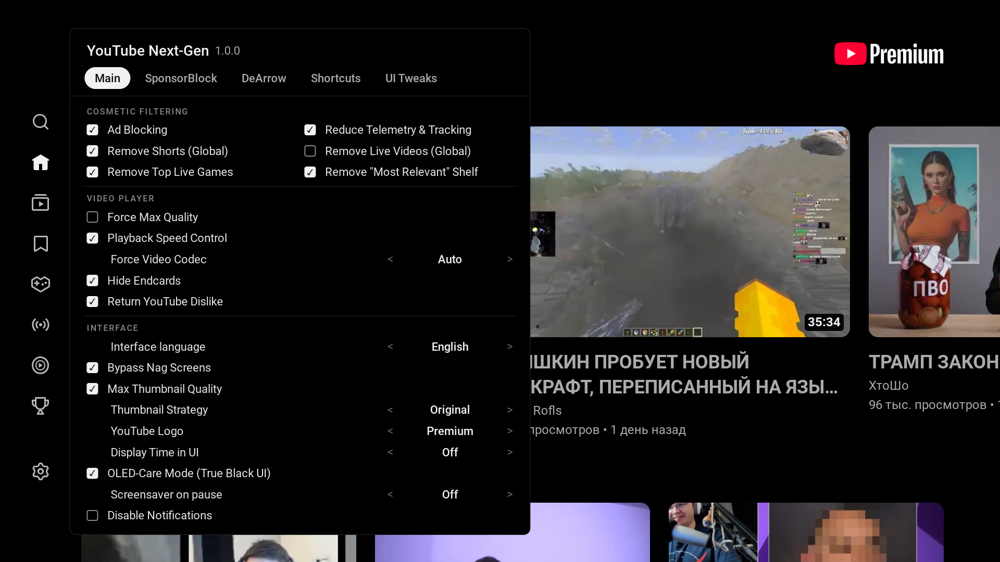

<p align="center">
  
</p>

<h1 align="center">YouTube Next-Gen for LG webOS</h1>

<p align="center">
  <b>Modern, lightweight, ad-free YouTube client for LG webOS Smart TVs</b><br>
  Featuring SponsorBlock, Return YouTube Dislike, variable playback speed, and pure True Black OLED mode.
</p>

<p align="center">
  <a href="https://github.com/emoorpheus/YoutubeNG/releases/latest"></a>
  
  <a href="LICENSE"></a>
  
</p>

<p align="center">
  <a href="README.ru.md"><b>🇷🇺 Читать документацию на русском языке</b></a>
</p>

---

## 🌟 Overview

**YouTube Next-Gen (YTNG)** is an enhanced YouTube application designed specifically for LG webOS TVs. It operates as an independent application (`youtube.nextgen`), installing side-by-side with the stock YouTube app without overwriting or interfering with it.

It brings essential desktop-class browser features directly to your television remote: seamless ad blocking, SponsorBlock segments, dislike counts, custom playback speeds with 1080p retention, and a specialized True Black theme tailored for OLED displays.

<p align="center">
  
  <br>
  <i>Home screen with True Black (#000000) OLED theme and uncluttered layout</i>
</p>

---

## ✨ Features

- 🛡️ **Complete Ad Blocking**: Blocks pre-roll, mid-roll, banner, and feed advertisements. Optional reduction of telemetry and tracking requests.
- ⏭️ **SponsorBlock Integration**: Automatically skips sponsors, intro animations, interaction reminders, and end-screen promos. Visual colored segment markers directly on the seek bar.
- 👎 **Return YouTube Dislike**: Real-time dislike counters integrated cleanly into the video description row next to likes.
- 🎯 **DeArrow (Optional)**: Replaces sensational clickbait titles and thumbnail faces with community-provided descriptive titles and clear video frames.
- ⚡ **WebCodecs Playback Speed (webOS 23+)**: Adjust video speed from 0.25× up to 2.0× while keeping the video resolution locked at crisp 1080p.
- 🌑 **OLED True Black Mode**: Replaces default grey backgrounds with pure `#000000` pixels across the browse interface, player controls, and start screen to maximize contrast and eliminate panel glow.
- 🌙 **Burn-in Protection Screensaver**: Pausing a video dims the screen into a moving ambient clock after 1 minute (configurable: 30s – 5min). Wakes up instantly on any remote keypress.
- 🎛️ **Minimalist Settings Panel**: Built from scratch for quick remote-control navigation. Available in both English and Russian.
- ✂️ **Interface Cleaners**: Optional toggles to hide YouTube Shorts, live stream shelves, end cards, and skip the "Who's watching?" account selector on launch.

---

## 📸 Screenshots

<table align="center" width="100%">
  <tr>
    <td width="50%" align="center"><b>Player with SponsorBlock & OLED Controls</b></td>
    <td width="50%" align="center"><b>Quick Settings Panel (Remote-Optimized)</b></td>
  </tr>
  <tr>
    <td align="center"></td>
    <td align="center"></td>
  </tr>
  <tr>
    <td align="center"><i>Visual colored SponsorBlock segments on the progress bar and OLED-dark player pill buttons</i></td>
    <td align="center"><i>Access settings at any time via the Green remote button or via YouTube's own Settings menu</i></td>
  </tr>
</table>

---

## 📦 Package Selection

Choose the installer matching your TV's webOS generation:

| Package | Supported webOS | Target Models | Size |
|---|---|---|---|
| **`youtube.nextgen_1.0.0_all_webOS22+.ipk`** | **webOS 22+ (6.x+)** | 2022, 2023, 2024, 2025+ models (Chromium 87+) | **~109 KB** *(Fastest & lightest)* |
| **`youtube.nextgen_1.0.0_all.ipk`** | **webOS 3.0 – 6.x** | Legacy & older models (Chromium 38+) | **~126 KB** *(Includes polyfills)* |

---

## 🚀 Installation

Ensure your TV is accessible in **Developer Mode** or has **Root** (via [webosbrew.org](https://webosbrew.org)).

### Method 1: webOS Dev Manager (Recommended GUI)
1. Download the appropriate `.ipk` from the [Releases](https://github.com/emoorpheus/YoutubeNG/releases) page.
2. Launch [webOS Dev Manager](https://github.com/webosbrew/dev-manager-desktop) on your computer.
3. Click **Install...**, select the `.ipk` file, and wait for confirmation.

### Method 2: webOS CLI (ares-cli)
```bash
ares-install -d tv youtube.nextgen_1.0.0_all_webOS22+.ipk
ares-launch -d tv youtube.nextgen
```

### Method 3: Rooted TV over SSH
```bash
scp youtube.nextgen_1.0.0_all_webOS22+.ipk root@TV_IP:/tmp/ng.ipk
ssh root@TV_IP 'luna-send -n 1 luna://com.webos.appInstallService/dev/install "{\"id\":\"youtube.nextgen\",\"ipkUrl\":\"/tmp/ng.ipk\",\"subscribe\":false}"'
```

*To uninstall:* `ares-install -d tv -r youtube.nextgen`

---

## 🎮 Remote Control & Shortcuts

| Button | Action |
|---|---|
| **Green** | Toggle YouTube Next-Gen Settings panel directly from any screen |
| **Back** | Close settings panel / Return to previous view |
| **Play / Pause** | Toggle playback / Instantly wake screen from pause screensaver |
| **Red** | *(Optional)* Quick shortcut to toggle OLED mode |
| **Blue** | *(Optional)* Manual SponsorBlock segment skip |
| **Numeric keys (0–9)** | Customizable in Settings → **Shortcuts** tab |

> [!TIP]
> You can also access settings without color buttons: navigate to the left navigation sidebar → **Settings** → click the top item **YouTube Next-Gen** → **Open settings**.

---

## 🌍 Language Configuration

YouTube Next-Gen is fully translated into **English** and **Russian**.
- By default, the interface automatically detects your YouTube language settings.
- To enforce a specific language: open Settings → **Main** → **Interface** → **Interface language** (choose `Auto`, `English`, or `Русский`).
- Interested in adding a new language? Each language is a concise key-value file in `src/i18n/`. Refer to [TRANSLATING.md](TRANSLATING.md) for details.

---

## 🛠️ Building from Source

**Requirements:** Node.js 22+, npm.

```bash
# Clone the repository
git clone https://github.com/emoorpheus/YoutubeNG.git
cd YoutubeNG

# Install dependencies
npm ci

# Run verification and benchmark suite
bash bench/run-all.sh

# Build both installers into dist/
npm run package:all
```

Outputs will be placed into the `dist/` directory:
- `dist/youtube.nextgen_1.0.0_all.ipk`
- `dist/youtube.nextgen_1.0.0_all_webOS22+.ipk`

---

## 💡 Notes & Details

- **Independent Session**: YouTube Next-Gen uses dedicated local storage separate from the stock YouTube app. You will need to log into your Google Account once on first launch.
- **Remote YouTube Button**: The physical "YouTube" button on LG remotes is hardcoded to the stock app. You can pin YouTube Next-Gen to your LG webOS Home launcher bar or use custom launcher tools like Hearth.
- **Privacy & Safety**: YouTube Next-Gen sends zero user data or telemetry to third parties. All network calls go strictly to YouTube, SponsorBlock, and Return YouTube Dislike public APIs. See [SECURITY.md](SECURITY.md).

---

## 📄 License & Credits

- Licensed under **GPL-3.0-only**. See [LICENSE](LICENSE) and [NOTICE](NOTICE).
- Fork of [youtube-webos](https://github.com/NicholasBly/youtube-webos) by NicholasBly, with playback speed enhancements from Schmiddisen and DeArrow by magicsk.
- *Disclaimer:* YouTube is a trademark of Google LLC. This project is an independent open-source initiative and is not affiliated with, authorized, or endorsed by Google LLC or LG Electronics.
