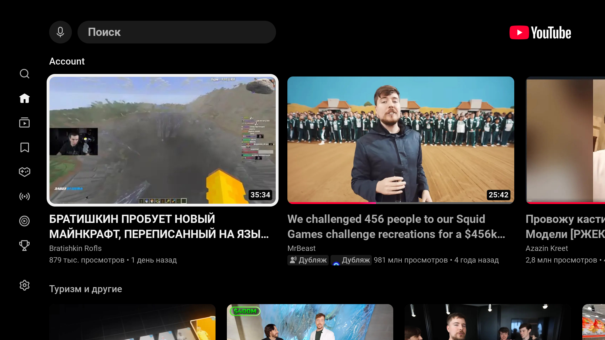
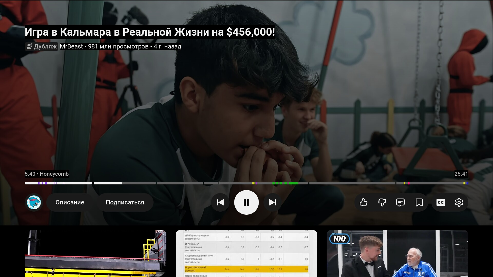
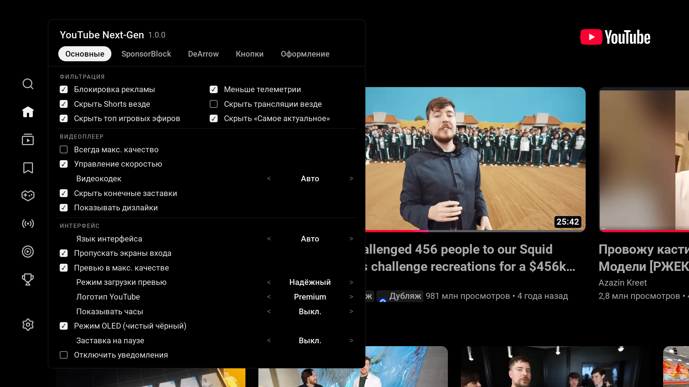

<p align="center">
  
</p>

<h1 align="center">YouTube Next-Gen для LG webOS</h1>

<p align="center">
  <b>Современный, быстрый клиент YouTube без рекламы для смарт-телевизоров LG webOS</b><br>
  Со SponsorBlock, Return YouTube Dislike, регулировкой скорости и истинным чёрным OLED-режимом.
</p>

<p align="center">
  <a href="https://github.com/emoorpheus/YoutubeNG/releases/latest"></a>
  
  <a href="LICENSE"></a>
  
</p>

<p align="center">
  <a href="README.md"><b>🇬🇧 Read documentation in English</b></a>
</p>

---

## 🌟 О проекте

**YouTube Next-Gen (YTNG)** — отдельное модифицированное приложение YouTube, разработанное специально для телевизоров LG на платформе webOS. Оно устанавливается как независимое приложение с собственным идентификатором (`youtube.nextgen`), сосуществует рядом со штатным клиентом YouTube и не перезаписывает его.

Приложение переносит на большой экран функции продвинутого браузера: полноценное удаление рекламы, пропуск спонсорских вставок (SponsorBlock), отображение дизлайков, изменение скорости без потери разрешения (1080p) и специальную тему True Black, созданную для экранов OLED.

<p align="center">
  
  <br>
  <i>Главный экран в режиме OLED: идеальный чёрный фон (#000000) без паразитного свечения матрицы</i>
</p>

---

## ✨ Основные возможности

- 🛡️ **Полная блокировка рекламы**: блокирует пре-роллы, мид-роллы, баннеры и рекламные карточки в ленте. Доступно опциональное отключение телеметрии и трекеров.
- ⏭️ **Интеграция со SponsorBlock**: автоматический пропуск рекламы от авторов, приветствий, заставок, напоминаний о подписке и саморекламы. Разноцветные метки категорий прямо на полосе прогресса.
- 👎 **Return YouTube Dislike**: точный счётчик дизлайков в режиме реального времени, встроенный в блок «Описание» ролика рядом с отметками «Мне понравилось».
- 🎯 **Поддержка DeArrow (опция)**: замена кликбейтных заголовков и гримасничающих превью на информативные названия и кадры из видео от сообщества.
- ⚡ **Контроль скорости на базе WebCodecs (webOS 23+)**: изменение скорости воспроизведения от 0.25× до 2.0× с сохранением стабильного разрешения 1080p.
- 🌑 **Режим «Истинный чёрный» (OLED Mode)**: замена стандартных темно-серых подложек на идеально чёрный цвет `#000000` в ленте, плеере, диалогах и на экране загрузки.
- 🌙 **Заставка для защиты от выгорания**: через 1 минуту нахождения на паузе (настраивается от 30 сек до 5 мин) экран затемняется, и по нему плавно перемещаются неяркие часы. Просыпается мгновенно от любой кнопки пульта.
- 🎛️ **Минималистичная панель настроек**: переработанное меню с удобной навигацией стрелками пульта. Полностью на русском и английском языках.
- ✂️ **Очистка интерфейса**: возможность отключить Shorts, полки со стримами, конечные заставки и автоматически пропускать экран выбора профиля («Кто смотрит?»).

---

## 📸 Скриншоты интерфейса

<table align="center" width="100%">
  <tr>
    <td width="50%" align="center"><b>Плеер: SponsorBlock и OLED-интерфейс</b></td>
    <td width="50%" align="center"><b>Меню настроек YouTube Next-Gen</b></td>
  </tr>
  <tr>
    <td align="center"></td>
    <td align="center"></td>
  </tr>
  <tr>
    <td align="center"><i>Цветные сегменты SponsorBlock на полосе перемотки и темные кнопки управления</i></td>
    <td align="center"><i>Быстрый доступ к настройкам по зеленой кнопке пульта или через меню YouTube</i></td>
  </tr>
</table>

---

## 📦 Какой пакет выбрать для установки

Выберите установочный файл в зависимости от поколения webOS вашего телевизора:

| Файл пакета | Поддерживаемая webOS | Модели ТВ | Размер |
|---|---|---|---|
| **`youtube.nextgen_1.0.0_all_webOS22+.ipk`** | **webOS 22+ (6.x+)** | Модели 2022, 2023, 2024, 2025+ гг. (Chromium 87+) | **~109 КБ** *(Максимально быстрый)* |
| **`youtube.nextgen_1.0.0_all.ipk`** | **webOS 3.0 – 6.x** | Старые модели и классические версии (Chromium 38+) | **~126 КБ** *(Содержит полифилы)* |

---

## 🚀 Установка на телевизор

Телевизор должен быть переведен в **Режим разработчика (Developer Mode)** или иметь **Root** (например, через [webosbrew.org](https://webosbrew.org)).

### Способ 1: webOS Dev Manager (рекомендуется)
1. Скачайте нужный файл `.ipk` со страницы [Releases](https://github.com/emoorpheus/YoutubeNG/releases).
2. Запустите [webOS Dev Manager](https://github.com/webosbrew/dev-manager-desktop) на компьютере.
3. Нажмите кнопку **Install...**, выберите файл `.ipk` и дождитесь уведомления об успешной установке.

### Способ 2: Через консоль webOS CLI (ares-cli)
```bash
ares-install -d tv youtube.nextgen_1.0.0_all_webOS22+.ipk
ares-launch -d tv youtube.nextgen
```

### Способ 3: Для ТВ с Root-доступом по SSH
```bash
scp youtube.nextgen_1.0.0_all_webOS22+.ipk root@TV_IP:/tmp/ng.ipk
ssh root@TV_IP 'luna-send -n 1 luna://com.webos.appInstallService/dev/install "{\"id\":\"youtube.nextgen\",\"ipkUrl\":\"/tmp/ng.ipk\",\"subscribe\":false}"'
```

*Для удаления приложения:* `ares-install -d tv -r youtube.nextgen`

---

## 🎮 Управление с пульта Magic Remote

| Кнопка | Действие |
|---|---|
| **Зелёная** | Быстрое открытие/закрытие панели настроек YouTube Next-Gen |
| **Назад (Back)** | Закрытие настроек / Возврат к предыдущему экрану |
| **Play / Pause** | Воспроизведение, пауза / Мгновенный выход из заставки на паузе |
| **Красная** | *(Опционально)* Быстрое переключение режима OLED |
| **Синяя** | *(Опционально)* Ручной пропуск спонсорского сегмента |
| **Цифровые клавиши (0–9)** | Настраиваемые горячие клавиши в меню настроек (**Кнопки**) |

> [!TIP]
> Открыть настройки можно и без цветных кнопок: перейдите в левое меню YouTube → **«Настройки»** → выберите верхний пункт **«YouTube Next-Gen»** → **«Открыть настройки»**.

---

## 🌍 Язык интерфейса

Приложение полностью переведено на **русский** и **английский** языки.
- По умолчанию язык определяется автоматически по языку приложения YouTube (**Авто**).
- Чтобы принудительно задать язык: откройте настройки → **«Основные»** → **«Интерфейс»** → **«Язык интерфейса»** (`Авто` / `Русский` / `English`).
- Хотите добавить перевод на свой язык? Каждый язык описан в отдельном файле в папке `src/i18n/`. Подробнее см. [TRANSLATING.ru.md](TRANSLATING.ru.md).

---

## 🛠️ Сборка из исходного кода

**Требования:** Node.js 22+, npm.

```bash
# Клонирование репозитория
git clone https://github.com/emoorpheus/YoutubeNG.git
cd YoutubeNG

# Установка зависимостей
npm ci

# Запуск полного набора тестов и бенчмарков
bash bench/run-all.sh

# Сборка обоих пакетов .ipk в папку dist/
npm run package:all
```

Собранные файлы появятся в каталоге `dist/`:
- `dist/youtube.nextgen_1.0.0_all.ipk`
- `dist/youtube.nextgen_1.0.0_all_webOS22+.ipk`

---

## 💡 Полезная информация

- **Изолированная сессия**: приложение хранит авторизацию и настройки в изолированном хранилище. При первом запуске потребуется один раз войти в свой аккаунт Google.
- **Кнопка YouTube на пульте**: фирменная кнопка на пульте LG жестко привязана системой к стандартному приложению. Рекомендуется вынести карточку YouTube Next-Gen в начало домашней ленты webOS.
- **Безопасность и приватность**: YouTube Next-Gen не собирает персональные данные и не отправляет телеметрию на сторонние серверы. Все запросы идут исключительно к публичным API YouTube, SponsorBlock и Return YouTube Dislike. См. [SECURITY.md](SECURITY.md).

---

## 📄 Лицензия и благодарности

- Распространяется под лицензией **GPL-3.0-only**. См. [LICENSE](LICENSE) и [NOTICE](NOTICE).
- Основано на [youtube-webos](https://github.com/NicholasBly/youtube-webos) от NicholasBly, с кодом изменения скорости от Schmiddisen и интеграцией DeArrow от magicsk.
- *Примечание:* «YouTube» является товарным знаком Google LLC. Данный проект является независимой разработкой с открытым исходным кодом и никак не связан с Google LLC или LG Electronics.
